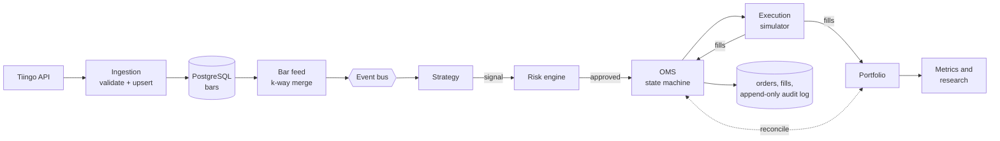

# Aegis Markets


An event-driven trading platform in Python, built to resemble real trading infrastructure: a validated market data pipeline, a strategy engine where look-ahead bias is structurally impossible, pre-trade risk checks, an order management system with an append-only audit log, a realistic execution simulator, portfolio accounting that reconciles against the order system, and research tooling for out-of-sample validation.

205 tests (199 backend, 6 frontend) run in CI on every push against a real PostgreSQL 18 database, including a migration drift check.

## What it does

- **Market data:** ingests daily OHLCV bars from the Tiingo API with retries and exponential backoff, parses prices straight into exact decimals, validates every bar, and stores them idempotently in PostgreSQL with source lineage. A data quality report checks every symbol against the trading calendar.
- **Strategy engine:** replays bars one at a time through a typed event bus. Strategies only ever receive an immutable window of past bars, and tests prove they can never see future data.
- **Risk engine:** sizes each position from its stop distance or to a volatility target, then runs configurable pre-trade checks (position size, exposure, risk per trade, daily loss, open positions, duplicates, stop required, buying power, kill switch). Working orders count toward limits, and exits are never blocked.
- **Order management:** orders move through an explicit state machine. Orders and fills are idempotent, and every state change is written to an audit log that a PostgreSQL trigger makes append-only.
- **Execution simulator:** fills at the next bar's open with slippage, commissions and volume limits; models gap risk on stops; attaches stop and target brackets as one-cancels-other orders.
- **Portfolio:** average-cost accounting with realized and unrealized P&L, interest on idle cash, a daily equity curve, and an accounting identity check after every run. Positions are reconciled against the order system's fills.
- **Research workflow:** hypotheses are pre-registered before testing, with success criteria defined as code. A locked holdout period is enforced in code and every unlock is logged. Each result records the commit, a content hash of the data and of the config, and is judged PASS or FAIL mechanically by tested code.
- **Paper trading:** forward paper accounts run a frozen strategy config from their start date. A daily runner fetches new bars, replays the account deterministically, checks every recorded day for drift, and appends the new day to an append-only ledger.
- **Dashboard:** a Next.js and TypeScript app with types generated from the API's OpenAPI schema. It runs backtests with return, drawdown and exposure charts and a sortable trade table, and shows each paper account's positions, fills, queued orders and ledger.

## Architecture



For each bar, handlers run in the order a trading day happens: working orders execute against the open, the strategy sees the completed bar, positions are marked to the close, and only then do new signals go through risk and become orders for the next bar.

## Key engineering decisions

- **Look-ahead bias is prevented by structure, not discipline.** The engine finishes every event caused by bar *t* before it reads bar *t+1*, strategies get immutable history, and orders cannot fill on a bar that started before they were submitted.
- **Money is never a float.** Prices and cash are `Decimal` from the vendor's JSON to the database. Statistics, which are estimates anyway, use floats.
- **Idempotency everywhere it matters.** Re-running ingestion never duplicates bars, a retried order returns the existing order, and a duplicate execution report is ignored instead of double-counting shares.
- **The audit log cannot be edited.** A PostgreSQL trigger rejects UPDATE, DELETE and TRUNCATE on order events, so even raw SQL cannot rewrite history.
- **Honest fills.** Stops fill at the open when the price gaps through them, slipped prices round against the trader, and when a stop and a target could both trigger inside one daily bar, the stop is assumed to happen first.
- **Strategies, risk and execution are separate.** Strategies emit signals and never size positions or touch money, so each layer can be tested and replaced on its own.
- **The books must balance.** Equity must equal starting cash plus realized and unrealized P&L minus commissions plus interest, and positions must match the order system's fills, or the run fails.

## Research findings

Every strategy idea was written down with its success criteria before it was tested, then judged by code. Results are in [docs/research/hypotheses.md](docs/research/hypotheses.md), with full generated reports in [docs/research/results](docs/research/results).

| Hypothesis | Result | What it showed |
|---|---|---|
| **H1:** trend following across 16 asset-class ETFs | Passed development, failed the locked 2023-2026 test | Sharpe 0.40 vs 0.41 for SPY with a max drawdown of -9% vs -52% in development, but in the bull-market holdout its correlation to stocks jumped from 0.38 to 0.67 |
| **H3:** short-term mean reversion in equity index ETFs | Failed development | Consistent across 513 trades and settings, but a Sharpe of 0.24 against a 0.5 requirement |
| **H2:** 70% SPY plus the trend sleeve | Failed development | Sharpe 0.43 vs 0.41 and a smaller drawdown, but correlation 0.99 and better than SPY in only 1 of 3 sub-periods |
| **H4:** SPY core plus both sleeves weighted by risk | Failed development | Nearly identical to simply holding about 67% SPY and 33% cash |

**Conclusion:** none of these strategies beats a plain index fund held at a chosen level of risk. The sleeves reduced drawdowns mostly by taking money out of stocks. Lessons carried forward: compare portfolios against SPY plus cash at the same volatility, allocate by risk rather than dollars, and measure profit concentration including open positions.

## Tech stack

**Backend:** Python 3.13, FastAPI, SQLAlchemy 2.0, PostgreSQL 18, Alembic, Pydantic, httpx, pytest

**Frontend:** Next.js, React, TypeScript, Tailwind CSS, Recharts, Vitest, openapi-typescript

**CI:** GitHub Actions with a PostgreSQL service container

## Getting started

Requirements: Python 3.13+, PostgreSQL 18, and a free [Tiingo](https://www.tiingo.com) API token.

**1. Database.** Create a user and database:

```sql
CREATE USER aegis WITH PASSWORD 'change_me';
CREATE DATABASE aegis OWNER aegis;
```

Or run it in Docker:

```bash
docker run --name aegis-postgres -e POSTGRES_USER=aegis -e POSTGRES_PASSWORD=change_me -e POSTGRES_DB=aegis -p 5432:5432 -d postgres:18
```

**2. Backend.**

```bash
cd backend
python -m venv .venv
source .venv/bin/activate        # Windows: .venv\Scripts\Activate.ps1
pip install -r requirements.txt
cp .env.example .env             # then set DATABASE_URL and TIINGO_API_KEY
alembic upgrade head
pytest -v
```

## Usage

Backend commands run from `backend/`.

Ingest daily bars and check data quality:

    python -m app.market_data.ingest --provider tiingo --symbols SPY TLT GLD --start 2007-01-01 --end 2026-10-09
    python -m app.market_data.quality

Run a backtest with full metrics against SPY:

    python -m app.backtest.run --symbols SPY QQQ TLT GLD --start 2008-01-01 --end 2023-01-01 --rf 0.02 --sizing volatility

Run the official evaluation of a pre-registered hypothesis:

    python -m app.research.evaluate H1

Create a paper account and record the latest complete trading day (run after 6 PM New York time):

    python -m app.paper.accounts create --name my-account --hypothesis H1 --purpose "why this account exists"
    python -m app.paper.run

Start the API (interactive docs at http://127.0.0.1:8000/docs) and the dashboard (http://localhost:3000):

    uvicorn app.main:app --reload
    cd ../frontend && npm install && npm run dev

Backtests run inside rolled-back transactions, so they leave no rows behind.

## Project structure

- `backend/app/api/` - FastAPI routes: health, readiness, bars, backtests, paper accounts
- `backend/app/market_data/` - domain model, providers (Tiingo, Alpaca, fake), ingestion, quality report, universes
- `backend/app/engine/` - events, event bus, bar feed, bar history, signal engine
- `backend/app/indicators/` - technical indicators (Wilder RSI)
- `backend/app/strategies/` - moving-average crossover, time-series momentum, mean reversion
- `backend/app/risk/` - limits, volatility tracking and the pre-trade risk engine
- `backend/app/oms/` - order state machine, order manager, models
- `backend/app/execution/` - cost model and execution simulator
- `backend/app/portfolio/` - snapshot and portfolio accounting
- `backend/app/trading/` - end-to-end pipeline
- `backend/app/backtest/` - metrics, backtest service and report, holdout lock
- `backend/app/research/` - hypothesis configs, evaluators, portfolio combiner, fingerprints, reports
- `backend/app/paper/` - paper accounts, replay, drift detection, daily runner
- `backend/migrations/` - Alembic migrations, including the append-only triggers
- `frontend/` - Next.js dashboard
- `docs/build-log.md` - engineering log: decisions, problems and results per milestone
- `docs/research/` - pre-registered hypotheses, results reports and the holdout log

## Limitations

- Daily bars only, so the order of prices within a day is unknown (handled with a pessimistic assumption).
- The research universe was chosen in 2026, so a mild form of selection bias remains.
- A flat interest rate is used for cash and the Sharpe ratio instead of historical T-bill rates.
- Long-only, and execution is simulated; there is no broker connection yet. The Alpaca provider is tested against a mocked API only.
- Portfolio hypotheses are simulated at the return level, not with share-level rebalancing in the engine.
- The daily paper runner needs a machine that is on after the market close.

## Roadmap

- Automatic weekday scheduling for the paper runner
- Share-level portfolio rebalancing in the engine, so portfolio hypotheses can be paper traded
- A broker adapter (Alpaca paper trading first) behind the existing order interface
- Live market data over WebSockets
- New pre-registered hypotheses using the lessons above, judged against a risk-matched benchmark
- An AI research agent producing structured analysis that feeds the strategy and risk layers, never placing trades directly
- A C++ order book and performance-critical components

## Author

Built by Breijon Peters. The [dev log](docs/build-log.md) records every milestone: what was built, why, what broke and what was learned.
